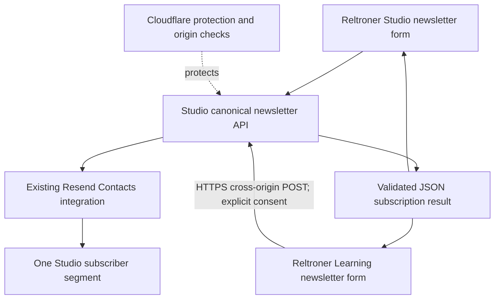

# Newsletter Integration — Production Operational

**Reltroner Studio × Reltroner Learning Academy**  
**Engineering and Early-Stage Business Case Study**

| Document field | Value |
|---|---|
| Status | **Production operational — successful subscription path verified** |
| Document date | November 3, 2026 (Asia/Jakarta) |
| Production rollout | November 2, 2026 (UTC) / November 3, 2026 (WIB) |
| Primary platform | [Reltroner Studio](https://www.reltroner.com/) |
| Additional distribution surface | [Reltroner Learning Academy](https://lms.reltroner.com/) |
| Canonical subscription API | `POST https://www.reltroner.com/api/newsletter` |
| Subscription system of record | Resend Contacts, using the existing Studio segment |
| Scope | Newsletter opt-in integration; **not** learning authentication, course delivery, or newsletter campaign delivery |

> **Evidence boundary:** “Production operational” here means that the deployed LMS form reached the shared Studio newsletter service and displayed its saved-subscription confirmation, while the tested address was visible as a subscribed contact in Resend. A successful CORS preflight was independently observed. The available screenshots do **not** disclose the exact HTTP status of the browser POST or establish that a new contact was created during the test. This document therefore does not claim measured subscriber growth, email delivery, or revenue.

## 1. Executive Summary

Reltroner Studio and Reltroner Learning Academy are two connected, still-developing surfaces of the same ecosystem. Studio serves as the central creative and brand presence. Learning Academy introduces structured learning experiences around worldbuilding, systems thinking, creative constraints, and related educational material.

The business requirement was straightforward: **visitors on `lms.reltroner.com` should be able to subscribe to the same Reltroner Studio newsletter without creating a separate newsletter product, subscriber database, or provider integration.** The LMS is an additional acquisition and opt-in surface, while Studio remains responsible for the canonical newsletter API, consent handling, subscriber persistence, and provider integration.

The solution reused the existing Studio API and Resend segment. A narrowly scoped CORS allowance permitted subscription submissions from `https://lms.reltroner.com`; the LMS changed its existing newsletter form from preview mode to live mode. Both sites now point to one subscription service and one subscriber source of truth.

This is **infrastructure and distribution readiness**, not proof of commercial traction. Its current value is reducing duplicated implementation and making it possible to collect explicit opt-ins across multiple Reltroner properties while the platform, content offering, and future business model continue to develop.

## 2. Problem and Business Context

### 2.1 The starting position

Before integration:

- The newsletter on Reltroner Studio used a canonical Cloudflare Pages Function and a Resend-backed contact segment.
- The LMS already displayed a newsletter section, but its code was configured as `mode: "preview"` with `endpoint: null`; validation occurred locally and no subscription was created.
- Studio's public newsletter endpoint enforced same-origin browser requests. A browser on `lms.reltroner.com` could not simply call the Studio endpoint and expect cross-origin access to work.
- The LMS was a static Next.js export on Cloudflare Pages. It did not need its own server-side Resend integration.
- Reltroner's platform and learning offering were under active construction; the goal was to enable a reusable distribution capability without adding operating cost or unnecessary infrastructure.

### 2.2 The concrete problem

The LMS newsletter component looked like a subscription form, but it was only a preview. This created a gap between the ecosystem's intended user journey and the available capability: a learner interested in future content could not subscribe from the LMS itself.

Creating a second newsletter implementation would have introduced avoidable problems:

1. **Fragmented audiences:** the same person could be represented in disconnected lists.
2. **Duplicated integration work:** separate API handlers, Resend configuration, secret management, and testing.
3. **Inconsistent consent and unsubscribe behavior:** two interfaces might evolve into different policies.
4. **Additional attack surface:** another endpoint or credentials-bearing service to protect and operate.
5. **Maintenance overhead:** more places to troubleshoot provider errors, quotas, and subscription state.

### 2.3 Desired outcome

A visitor should be able to opt in from either site, but both paths should converge on the **same Studio-managed subscription service and Resend audience**, with a clear consent statement and truthful outcome messages.

The LMS must act as a **distribution channel for the same newsletter**, not as a competing or independent newsletter program.

## 3. Architectural Decision

**Decision:** Keep newsletter ownership in Reltroner Studio. Extend its existing endpoint with an exact allowlist for the LMS browser origin. Configure the static LMS frontend to submit to that canonical endpoint.



**System responsibilities**

| Component | Responsibility | Explicitly not responsible for |
|---|---|---|
| Studio website | Primary newsletter subscription surface | Managing a separate LMS-specific audience |
| Studio Cloudflare Pages Function | Validating requests and consent, enforcing origin checks, invoking the existing provider adapter | Creating LMS accounts or learning records |
| Studio Resend provider | Contact lookup, deduplication, approved segment membership, persistence verification, subscription preference safeguards | Automatically sending a welcome email on opt-in |
| LMS website | Displaying the opt-in form, validating input, submitting to Studio, reporting the result | Holding provider secrets, storing contact records, or running a second subscription API |
| Cloudflare security controls | Request-rate mitigation and protection of the canonical API endpoint | Proving email ownership or replacing provider-level safeguards |

**Alternatives intentionally avoided:** deploying Resend credentials to the LMS, creating an LMS newsletter database, introducing another subscriber segment, or adding a separate LMS serverless proxy merely to mirror the Studio API.

## 4. Implementation

### 4.1 Canonical API: Reltroner Studio

Repository: [`Reltroner/reltroner-studio`](https://github.com/Reltroner/reltroner-studio)

Relevant files:

- [`functions/api/newsletter.ts`](https://github.com/Reltroner/reltroner-studio/blob/main/functions/api/newsletter.ts)
- [`lib/forms/request.ts`](https://github.com/Reltroner/reltroner-studio/blob/main/lib/forms/request.ts)
- [`lib/security/request-origin.ts`](https://github.com/Reltroner/reltroner-studio/blob/main/lib/security/request-origin.ts)
- [`lib/newsletter/resend-provider.ts`](https://github.com/Reltroner/reltroner-studio/blob/main/lib/newsletter/resend-provider.ts)
- [`tests/newsletter-lms-cors.test.mjs`](https://github.com/Reltroner/reltroner-studio/blob/main/tests/newsletter-lms-cors.test.mjs)

The Studio endpoint remained the only public newsletter subscription API. It received a **narrow newsletter-specific origin exception** for:

```text
https://lms.reltroner.com
```

Its canonical target remained:

```text
https://www.reltroner.com/api/newsletter
```

The change added:

- Exact origin and destination checks rather than an `Access-Control-Allow-Origin: *` policy.
- A dedicated `OPTIONS` preflight response permitting the intended `POST` with the required request headers.
- Appropriate CORS headers on responses to approved LMS requests, including validation and failure responses.
- Continued same-origin behavior for Studio's own form.
- Default same-origin validation for other form handlers, including Contact; the LMS exception is **not** a global form/API permission.
- Deterministic tests of allowed and rejected origins, request methods, request headers, response handling, and the unchanged Contact boundary.

A preflight acceptance is not a subscription. It authorizes the browser request pattern; the actual `POST` still passes through request validation and the existing subscription service.

### 4.2 LMS frontend: activate the existing form

Repository: [`Reltroner/LMS-FE`](https://github.com/Reltroner/LMS-FE)

Relevant files:

- [`src/lib/newsletter/config.ts`](https://github.com/Reltroner/LMS-FE/blob/main/src/lib/newsletter/config.ts)
- [`src/lib/newsletter/client.ts`](https://github.com/Reltroner/LMS-FE/blob/main/src/lib/newsletter/client.ts)
- [`src/lib/newsletter/schema.ts`](https://github.com/Reltroner/LMS-FE/blob/main/src/lib/newsletter/schema.ts)
- [`src/components/newsletter/NewsletterForm.tsx`](https://github.com/Reltroner/LMS-FE/blob/main/src/components/newsletter/NewsletterForm.tsx)
- [`src/components/newsletter/GlobalNewsletterSection.tsx`](https://github.com/Reltroner/LMS-FE/blob/main/src/components/newsletter/GlobalNewsletterSection.tsx)
- [`src/components/layout/PrototypeBanner.tsx`](https://github.com/Reltroner/LMS-FE/blob/main/src/components/layout/PrototypeBanner.tsx)

The LMS configuration changed from a preview-only form to:

```ts
export const newsletterIntegration = {
  mode: "live",
  endpoint: "https://www.reltroner.com/api/newsletter",
};
```

The browser client continues to:

- Require a valid email address and explicit affirmative consent.
- Send a single HTTPS JSON `POST` with **credentials omitted**.
- Avoid automatic retries when the outcome is uncertain.
- Enforce a bounded request timeout and refuse to treat redirects, HTML error pages, or untrusted response shapes as confirmed subscriptions.
- Display the returned subscription status without claiming email delivery or email-address verification.

The LMS prototype banner was also corrected. Learning account, progress, and mentorship capabilities remain identified as previews, while newsletter subscription is described as provided by Studio.

**No new LMS Resend key, subscriber table, backend endpoint, or provider dependency was introduced.**

### 4.3 API request and response contract

A normal, consented submission has this shape:

```http
POST /api/newsletter HTTP/1.1
Host: www.reltroner.com
Origin: https://lms.reltroner.com
Content-Type: application/json
Accept: application/json
```

```json
{
  "email": "reader@example.test",
  "consent": true
}
```

The service normalizes and validates the address, then delegates to the existing Studio subscription provider. An example of the confirmed persistence result is:

```json
{
  "status": "accepted",
  "message": "Your subscription was saved in Resend. No email was sent.",
  "delivered": false,
  "verified": false
}
```

`delivered: false` and `verified: false` are part of the API's deliberately narrow claims. They must **not** be reinterpreted as a sent newsletter or a verified email address. An already-active member may receive a `duplicate` outcome instead of creating a new contact.

The provider also refuses to silently reactivate previously unsubscribed contacts. The proposed 30-day re-subscription workflow remains **unimplemented** without a trustworthy unsubscribe timestamp and an authorized renewed-consent mechanism.

## 5. Production Security and Cost Controls

### 5.1 CORS boundary

The LMS receives a targeted cross-origin exception; it does not gain privileged access to Studio or Resend. The implementation rejects arbitrary origins and unapproved destinations. No browser credentials or cookies are needed for this newsletter operation.

The tested preflight response was:

```text
HTTP 204 No Content
Access-Control-Allow-Origin: https://lms.reltroner.com
Access-Control-Allow-Methods: POST
Access-Control-Allow-Headers: Content-Type, Accept
Access-Control-Max-Age: 600
Vary: Origin, Access-Control-Request-Method, Access-Control-Request-Headers
```

### 5.2 Cloudflare rate limiting

At verification time, the existing Cloudflare rule **`reltroner-newsletter-protection`** was reported as active with these settings:

| Setting | Value |
|---|---|
| Expression | `http.request.uri.path eq "/api/newsletter"` |
| Aggregation characteristic | Source IP |
| Threshold | 3 requests per 10 seconds per IP |
| Action | Block |
| Mitigation duration | 10 seconds |

Because the rule matches the **path**, not only `POST`, browser `OPTIONS` requests may also count against the threshold. The successful preflight uses a 600-second browser preflight cache to reduce repeated OPTIONS traffic. This is an operational consideration rather than proof that every edge/rate-limit case has been tested.

Studio retains its existing provider activation checks, usage controls, and Resend configuration. The LMS has no provider API key. No additional paid platform component was required for this integration; this does **not** establish zero total operating cost or unlimited free usage.

### 5.3 Privacy and consent

The LMS form explicitly tells visitors that they are opting in to **Reltroner Studio updates**, and it links to Studio's privacy and unsubscribe/preferences information. The flow is opt-in only; visiting the LMS, enrolling in a course, or opening the page does not subscribe a person automatically.

A future source-attribution feature would require separate design and privacy review. The current implementation should **not** be described as measuring which site produced each contact.

## 6. Deployment and Verification Evidence

### 6.1 Release sequence

The server-side CORS change was merged and deployed before the LMS live-form change.

| Milestone | Evidence |
|---|---|
| Studio PR merged | [Studio PR #26](https://github.com/Reltroner/reltroner-studio/pull/26), merge commit `cc0da3cd66d1ca896a1120743dc2b07ff16256f0` |
| Studio build/deploy | Cloudflare Pages reported **“Success: Your site was deployed!”** on November 2 at approximately 21:06:34 UTC |
| LMS PR merged | [LMS PR #11](https://github.com/Reltroner/LMS-FE/pull/11), merge commit `f35dc060ebc9500b70faf39a2bfd1dfc7f126f2e` |
| LMS build/deploy | Cloudflare Pages reported **“Success: Your site was deployed!”** on November 2 at approximately 21:07:20 UTC |
| Studio build | Next.js compilation, TypeScript, static pages, asset verification, and Pages Functions compilation passed in the supplied deployment log |
| LMS build | Next.js compilation, TypeScript, public-output privacy check, and static export passed in the supplied deployment log |

Studio's Pages Function serves the dynamic API. The LMS's `No functions dir ... Skipping` deployment message was expected because the LMS is a static export.

### 6.2 Runtime acceptance evidence

**Gate 1 — Cross-origin preflight: PASS**

An operator-run Windows PowerShell `OPTIONS` request to the production Studio endpoint received `HTTP 204` and the expected exact LMS origin, method, allowed headers, and `Vary` values.

**Gate 2 — LMS live user interface: PASS**

At mobile width (375 px), the LMS newsletter displayed **“Subscribe to Studio updates”**, not the former preview-only label. The visitor selected the explicit consent checkbox and submitted the form.

**Gate 3 — Application result: PASS for the observed successful path**

The LMS displayed:

> Your subscription was saved in Resend. No email was sent.

This is the expected affirmative persistence message from the canonical service. The supplied Network screenshot did not expose the actual POST HTTP status or the full JSON payload; those details should not be invented.

**Gate 4 — Subscriber state: corroborated**

The operator's Resend dashboard showed the tested address in the existing Studio segment with a **Subscribed** status. The displayed audience snapshot contained **4 contacts, 4 subscribers, and 0 unsubscribers**.

The contact's displayed addition date was approximately **19 days earlier**. Therefore, the evidence supports a working shared-audience flow and existing contact membership, **not** a claim that this test created a new subscriber or increased the count from three to four.

### 6.3 Verification matrix

| Acceptance gate | Result | What is actually established |
|---|---|---|
| Studio API deployed | PASS | New canonical endpoint handler reached Cloudflare production deployment |
| LMS frontend deployed | PASS | Live newsletter configuration reached Cloudflare production deployment |
| Preflight CORS | PASS | Production `OPTIONS` returned the expected `204` and LMS allowlist headers |
| Consent-based LMS submission | PASS | The form accepted explicit opt-in and displayed the Studio persistence message |
| Shared Resend audience | CORROBORATED | Tested contact visible as subscribed in the existing Studio segment |
| New-contact creation during test | NOT ESTABLISHED | Dashboard indicated a pre-existing contact |
| Exact browser POST HTTP status | NOT CAPTURED | Network row/status was not provided in the screenshots |
| Production 429/timeout/failure-path behavior | NOT LIVE-TESTED HERE | Covered in code/tests, but not in the supplied positive-path proof |
| Newsletter broadcast delivery | NOT TESTED / NOT IN SCOPE | Opt-in does not send a newsletter |
| Revenue or conversion uplift | NOT MEASURED | No attribution, campaign, or monetization outcome established |

## 7. Business Value at Reltroner's Current Stage

Reltroner is still building its public content, learning experience, operational infrastructure, and audience relationships. The newsletter integration is best understood as **shared distribution infrastructure** rather than an immediate monetization feature.

| Potential value | Why it matters now | Evidence level |
|---|---|---|
| **One audience across properties** | Visitors interested in Studio or Learning can opt in to the same list, avoiding unnecessary product fragmentation. | Architecture implemented; shared membership observed |
| **Lower integration duplication** | One provider integration, contact model, set of secrets, and subscription policy is simpler to maintain than two independently managed systems. | Design/implementation fact; cost savings not quantified |
| **An owned communication channel** | Explicit subscribers may later receive updates about new learning material, creative content, and ecosystem milestones, subject to consent and actual campaigns. | Capability available; ongoing engagement not yet measured |
| **Cross-surface discoverability** | A learner who arrives at LMS can opt in to Studio communications without navigating to the Studio website first. | New entry point operational; traffic/conversion impact unknown |
| **Future launch readiness** | When more lessons, courses, and initiatives are genuinely published, the same list can support announcements without rebuilding newsletter infrastructure. | Future option, not a promise of releases |
| **Consistent privacy and operational controls** | Shared handling reduces the chance of contradictory unsubscribe/consent logic across products. | Shared canonical service; controls still require monitoring |
| **A production engineering proof point** | Demonstrates deployment coordination, CORS design, security scope management, provider integration, and evidence-based verification across two repositories. | Supported by merged PRs, deployment logs, and runtime evidence |

### 7.1 What the integration does *not* prove

It does not establish product-market fit, paying customers, qualified sales leads, subscriber growth attributable to the LMS, increased retention, email-open performance, or revenue. It also does not replace the work needed to build and publish more learning experiences.

The immediate outcome is more modest and more useful: **Reltroner can now accept permission-based Studio newsletter subscriptions from an additional production surface using the same operational backend.**

### 7.2 Sensible measures for the next stage

Track outcomes only when measurement can be implemented with an appropriate privacy and consent model:

- Valid opt-in attempts, confirmed subscriptions, duplicates, and failure rates at the canonical service.
- Rate-limit and CORS error counts, without logging raw email addresses or sensitive request content.
- Subscriber growth over time at the shared Resend audience level.
- Source attribution between Studio and LMS **only if explicitly implemented and disclosed**; it is not available as a proven current metric.
- Broadcast engagement and useful return visits **only after** actual, consent-compliant campaigns exist.

Avoid inventing numerical KPIs or targets until a baseline exists.

## 8. Operational Runbook

| Symptom | First checks | Safe response |
|---|---|---|
| LMS still shows “Preview newsletter opt-in” | Current LMS deployment SHA, cached HTML/JS, `newsletterIntegration.mode` | Verify deployment and cache state; do not add another API |
| CORS preflight fails | Exact Origin, target hostname/path, `OPTIONS`, allowed request headers, Cloudflare response | Fix the narrow allowlist or deployment issue; never use wildcard CORS as a shortcut |
| HTTP 403 | Origin enforcement, request validation, Cloudflare block events | Inspect the rejection cause; do not weaken the cross-origin boundary globally |
| HTTP 429 or Cloudflare block page | `/api/newsletter` rule, number of OPTIONS+POST requests, `Retry-After` | Honor the limit and wait; no rapid retry loops |
| HTTP 502/503 or HTML response | Studio Function execution, activation controls, provider status, edge diagnostics | Treat subscription as unconfirmed; do not claim success or retry automatically |
| Contact already subscribed | Existing segment membership | Interpret the duplicate outcome as expected deduplication, not a new acquisition |
| Previously unsubscribed contact rejected | Stored unsubscribe/suppression state and current re-subscribe policy | Respect suppression; do not silently reactivate or assume a 30-day threshold is supported |
| Resend shows a contact but no email arrives | Difference between subscription persistence and a broadcast | No email is expected from the subscription operation alone |

**Operational safety:** Avoid repeated production tests using personal addresses. Use an authorized test mailbox, explicit consent, and the smallest number of submissions needed. Do not publish email addresses, keys, tokens, or full private provider logs in issue reports.

### Rollback boundary

If the LMS opt-in is disrupted, the least invasive rollback is to restore its form to preview/unavailable mode while investigating, leaving Studio's existing same-origin newsletter available. If the Studio CORS allowance is found insecure, narrow or revert that exception without disabling the canonical service, WAF, or unrelated Contact protections. Any rollback must follow the actual deployment workflow and be verified before claims of recovery.

## 9. Remaining Limitations and Follow-up Work

1. **End-to-end failure-path observation:** no production evidence in this record for blocked requests, provider timeout, or 429 recovery; existing deterministic tests are not equivalent to all edge behaviors.
2. **Verified new-subscriber test:** the sample shown in Resend was already present. A fresh-contact creation test was not established and is not required to repeat solely for this document.
3. **Unsubscribe and re-subscribe policy:** users can manage newsletter preferences through Studio's established pathways. A general 30-day reactivation capability is not implemented and must not be implied.
4. **Attribution:** Studio and LMS submissions share the same audience without proven origin-level acquisition analytics. This is intentionally deferred.
5. **Campaign operations:** no welcome email, scheduled broadcast, delivery result, or marketing automation was established by this integration.
6. **Mobile presentation:** the floating AI control may overlap nonessential footer text in some mobile views. It was separately observed as a pre-existing UI issue, not a newsletter persistence failure.
7. **Ongoing protection:** periodically confirm the Cloudflare rate-limit rule, provider usage limits, privacy disclosures, and subscription status handling after future platform changes.

## 10. Final Outcome

**NEWSLETTER INTEGRATION — PRODUCTION OPERATIONAL**  
**Scope of acceptance: the observed successful, consent-based LMS-to-Studio subscription path.**

Reltroner Studio remains the authoritative newsletter service. Reltroner Learning Academy now distributes the same opt-in capability to learners without creating an independent newsletter system. The production deployment, exact-origin CORS preflight, LMS confirmation message, and observed Resend membership establish that the intended shared-service architecture is functioning for the tested path.

This is a small but meaningful step in Reltroner's development: a reusable communication foundation spanning multiple properties, achieved without unnecessary infrastructure duplication. Its business potential depends on future published content, a genuinely engaged audience, responsible newsletter operations, and outcomes that will need to be measured rather than assumed.

## 11. Reference Links

**Production**

- Reltroner Studio: https://www.reltroner.com/
- Reltroner Learning Academy: https://lms.reltroner.com/
- Canonical newsletter endpoint: https://www.reltroner.com/api/newsletter

**Code and rollout**

- Studio repository: https://github.com/Reltroner/reltroner-studio
- LMS-FE repository: https://github.com/Reltroner/LMS-FE
- Studio CORS integration: https://github.com/Reltroner/reltroner-studio/pull/26
- LMS newsletter activation: https://github.com/Reltroner/LMS-FE/pull/11
- Studio merge SHA: `cc0da3cd66d1ca896a1120743dc2b07ff16256f0`
- LMS merge SHA: `f35dc060ebc9500b70faf39a2bfd1dfc7f126f2e`

**Verification sources**

- Cloudflare Pages build/deployment logs shared by the operator (November 2, 2026 UTC).
- Operator-run production PowerShell `OPTIONS` preflight (`HTTP 204`, exact LMS allowlist headers).
- Mobile LMS subscription-form screenshots showing explicit consent and the Studio persistence message.
- Resend audience screenshot showing subscribed membership, with four contacts in the observed snapshot.

---

*Document prepared as a point-in-time record of a successful production integration. It should be updated if the endpoint contract, provider configuration, consent policy, deployment architecture, or business measurement capabilities materially change.*
